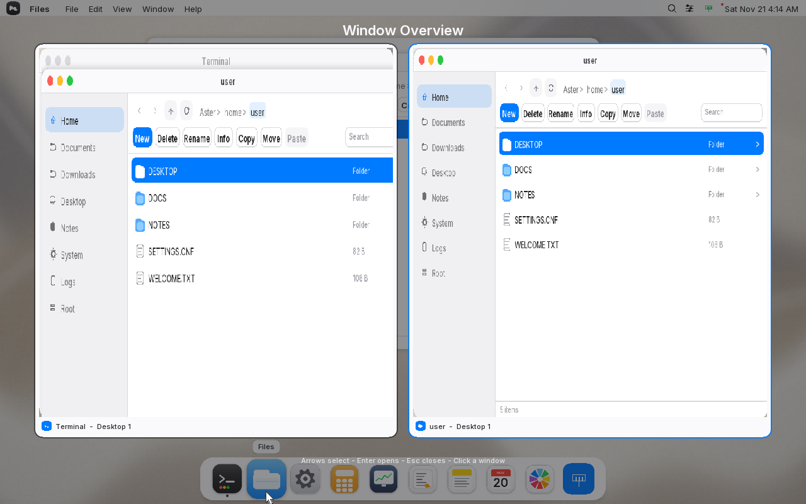
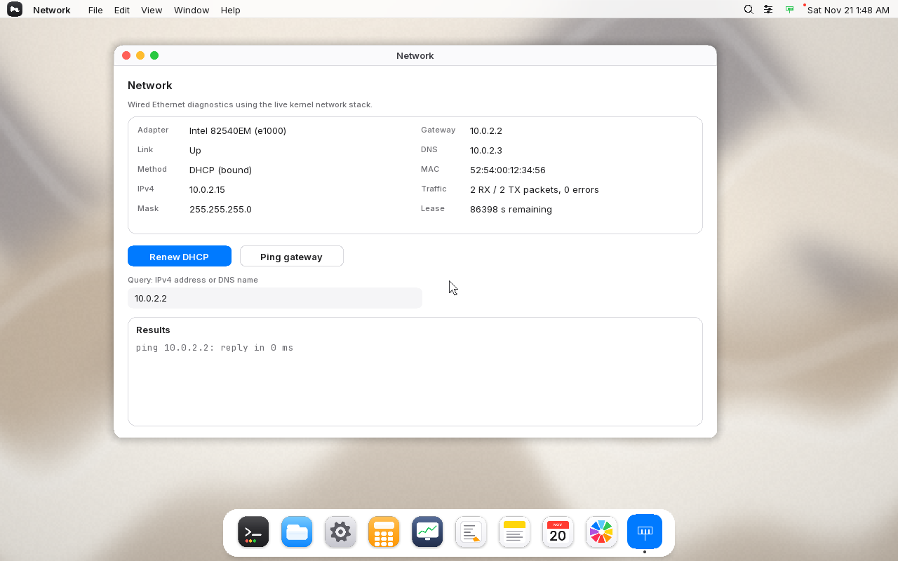

# Aster OS

**A new generation of personal computing.**

Aster OS is an independent, from-scratch desktop operating system for x86_64.
It is **not** a Linux distribution, **not** a modified Windows or macOS, and
**not** a desktop mockup. It has its own UEFI bootloader, higher-half kernel,
memory manager, scheduler, system-call ABI, filesystem, input stack, and a
ring-3 desktop environment with a light, macOS-inspired software compositor, a time-based animation engine, dirty-region rendering, isolated child processes, a block/mount storage stack, a persistent FAT32 home volume, a user-space settings service and a real wired IPv4 network stack.


## Status: 0.6.0 platform and devices (in progress)

This repository contains a working, bootable system on QEMU (UEFI + GPT/FAT32
disk image). The current milestone is a **single-CPU developer preview**:

| Area | What actually works |
|---|---|
| Boot | Aster Boot (own UEFI loader), GPT + FAT32 ESP, ELF kernel loading, custom page tables, `ExitBootServices`, higher-half handoff |
| Kernel | GDT/TSS, IDT, 256 vectors, exceptions, ACPI fixed tables, Local APIC + IOAPIC ISA routing with PIC fallback, PIT at 1 kHz, 4-level paging, bitmap frame allocator, kernel heap (`alloc`), preemptive scheduler, ring-3 processes, syscalls via `int 0x80` (POWER 47) |
| Memory | 4 KiB frames, 32 GiB addressable bitmap, per-process PML4, NX/W^X user mappings, heap self-tests, user copy validation |
| Drivers | COM1 serial, UEFI GOP framebuffer, PS/2 keyboard + mouse (IRQ driven), PIT, PCI config, AHCI (q35, polling), Intel 82540EM (e1000, polling); ACPI S5/reset |
| Filesystem | VFS + mount table; ramfs root for system files, FAT32 at `/home/user` with create/read/write/mkdir/rename/unlink |
| Desktop | Aster Desktop in ring 3: light menu bar, Spotlight, Dock 2.0 (bottom/left/right, size, magnification, auto-hide), animated window manager, Window Overview (F3), Alt+Tab switcher, workspace slides, Control Centre and notifications |
| Storage | Block registry with capacity/bounds/flush/counters, mount table, GPT + FAT32 at `/home/user`; v1 settings with backup; Settings reports device, filesystem, capacity, used/free and I/O |
| Network | e1000 Ethernet, ARP, IPv4, ICMP, UDP, DHCP client, DNS client, TCP client, blocking sockets; live menu bar, Network app, Settings and Monitor integration |
| Processes | Private PML4 per process; `SPAWN`/`WAIT`; zombie reaping; every ring-3 exception contained; isolation probe with exit status 42 and a deliberate fault returning -11 |
| Services | `configd` (ring 3) owns validated settings over IPC; desktop supervisor restarts it; direct-I/O fallback; timed IPC receive |
| Files | Real create, rename, delete, copy, move, info, sort, search, forward/back and breadcrumbs on the mounted filesystem |
| Graphics | Software compositor with dirty-region repaint, partial present, real window opacity, shadows, transparency/effects switches, Quality/Balanced/Performance/Adaptive modes and a shared motion engine |
| Monitor | CPU/memory/process cards, storage usage, network and real graphics telemetry (FPS, frame/draw/present time, dirty pixels, redraws), kernel-log view |
| IPC | Kernel channels with per-process handles, 256-byte messages, blocking send/receive, close/hangup; ping-pong verified between isolated processes |
| Apps | Terminal (real shell + ramfs), Files, Settings, Calculator, Monitor, Text, Notes, Calendar, Wallpapers, Network |
| Tests | Image verifier, block/mount/FAT self-tests, boot smoke, UI/pointer/files probes, persistence, isolation, settings/service tests, live network tests and a graphics/window animation acceptance test |

Everything in the table is exercised by booting the system and driving it, not
by static screenshots. Known gaps are listed in
[docs/FEATURES.md](docs/FEATURES.md), [docs/PROJECT_STATUS.md](docs/PROJECT_STATUS.md)
and [docs/releases/0.6.0/KNOWN_LIMITATIONS.md](docs/releases/0.6.0/KNOWN_LIMITATIONS.md).
Networking is IPv4-only and still polls the e1000; MSI, interrupt-driven e1000/AHCI,
USB, Device Manager, hardware inventory and PS/2 wheel are not implemented in this
in-progress 0.6.0 branch. ACPI S5/reset and APIC/IOAPIC routing are real and tested.
routing; there is no IPv6, TLS, inbound TCP listener or persistent static
configuration yet. There is no audio, USB, AFS/journaling, SMP, GPU
acceleration, full application sandboxing, package manager, installer, updater
or browser. The FAT32 home uses 8.3 names and has no journal.
Store/Installer/Update/Browser are deliberately **not** present in the UI.

## Quick start

Requirements: Rust (stable), QEMU 8+, OVMF/UEFI firmware, Python 3.10+.
The build uses `rust-lld`; Clang and NASM are not required.

```bash
rustup target add x86_64-unknown-none x86_64-unknown-uefi
python tools/fetch_firmware.py        # downloads the OVMF test firmware (BSD)
python tools/build.py                 # bootloader + kernel + desktop + disk image
python tools/run.py                   # boot in QEMU (interactive window + serial)
```

Headless smoke test:

```bash
python tools/run.py --headless --timeout 12 --screenshot build/screen.ppm
python tools/test.py                  # build + host image tests + boot assertions
python tools/net_test.py              # real DHCP, ICMP, TCP, UDP and DNS test
python tools/graphics_test.py         # dirty rendering, animations, overview, switcher, tabs
```

Full instructions, supported hosts, and troubleshooting:
[docs/development/BUILDING.md](docs/development/BUILDING.md).

## Desktop

The desktop runs as PID 1 in ring 3 (`/DESK` loaded by the bootloader). The
kernel only exposes a framebuffer mapping, input events, time, memory, and
filesystem syscalls; it contains no UI code.

- Menu bar: Aster brand tile, application name, working File/Edit/View/Window/Help
  menus, Spotlight, Control Centre, live Ethernet status, clock and notification centre.
- Dock: generated squircle app icons, magnification, running indicators,
  tooltips, click to launch or focus.
- Spotlight: `Ctrl+Space`, centred translucent search panel, keyboard
  navigation, filtered results; the panel resizes to the result count.
- Windows: explicit state machine, macOS-style traffic lights and centred
  titles, drag, eight-way resize, animated open/close/minimize/restore,
  maximize/unmaximize, snap-to-halves with preview, real opacity fades and
  focus-shadow transitions.
- Control Centre: light-only appearance, real display brightness, reduce
  motion, accent colour, a live Ethernet tile (address or link state) and an
  honest "No adapter" row for Bluetooth and audio. There is no dark mode in
  this build.
- Multitasking: F3/Ctrl+Up Window Overview with real captured previews,
  held-Alt+TAB quick switcher, three workspaces with slide transitions and
  indicators, and Text editor tabs.
- Shortcuts: `Ctrl+Space` Spotlight, `Ctrl+W` close, `Ctrl+M` minimize,
  `Ctrl+Tab` cycle, `Ctrl+Left/Right` virtual desktops.

### Design


Storage is layered: AHCI -> block registry -> mount table -> FAT32/ramfs, with
capacity checks, flush and I/O counters. The home directory is a real FAT32
volume on a second QEMU disk. Files,
notes and preferences survive a reboot; `tools/persistence_test.py` writes in
the guest, verifies the volume with an independent host parser, reboots, and
reads the data back. The boot image is never written by the kernel. The volume
uses 8.3 names and has no journal yet, and Settings states both limits.

Settings are versioned (`version=1`), validated per key and written through a
temporary file with a backup. `configd` owns them in the normal path; the
desktop supervisor restarts it on failure and falls back to direct I/O so the
session is never locked out. The Graphics & Motion page controls real
performance, dock and effect parameters. See
[0.5.0 release docs](docs/releases/0.5.0/).

### Graphics and motion



The compositor renders only dirty regions and presents only the changed
rectangles; idle frames are skipped. Window geometry and opacity come from a real
state machine and a time-based motion engine, with dock-targeted minimize and
restore animations. The engine is **software-only**: there is no GPU backend,
and the Monitor reports the software renderer instead of inventing GPU load.

### Networking



The kernel drives an Intel 82540EM (e1000) with real MMIO, DMA rings and a
simultaneous receive/transmit path. Ethernet II, ARP, IPv4, ICMP, UDP, a DHCP
client, a DNS client and a TCP client run in a kernel network thread; user
processes use blocking socket syscalls. The Network app, Settings, Monitor and
the menu bar all show live state. `tools/net_test.py` boots the system with
QEMU user-mode networking and verifies DHCP, ping, TCP echo (including a 64 KiB
bulk transfer), UDP echo and DNS against host-side servers. The driver is
polled because this milestone has no APIC/PCI IRQ routing; IPv6 and TLS are
architecture-only work in this release.

The desktop is light-only by product decision and follows macOS interaction
patterns without copying Apple code or artwork: a translucent menu bar, a
Spotlight-style launcher, traffic-light window controls, a bottom dock and
soft, layered surfaces. The supplied Aster logo (`assets/Logo/Logo.png`) is
used in the menu bar, notifications and the About page. The app icons are
original artwork: nine generated by `tools/icongen.py` and the Network icon
drawn in `ui.rs`; the four wallpapers are procedural (Sonoma, Sequoia,
Ventura, Monterey). All icons and wallpapers are drawn or generated by this
project.

Design tokens and interaction rules: [docs/design/](docs/design/).

## Repository layout

```
boot/        Aster Boot - UEFI loader (Rust, no_std)
kernel/      Aster Kernel - higher-half x86_64 kernel (Rust, no_std + alloc)
shared/      Boot ABI and syscall ABI shared by kernel/user space
user/        Aster Desktop and built-in applications (ring 3, no_std)
tools/       Build, image, QEMU, font/icon/logo generation and test tooling
tests/       Host-side unit tests
docs/        Architecture, research, ADRs, design system, security, benchmarks
assets/      Font atlas, supplied logo, generated icon set and wallpapers
```

There are no empty scaffolding directories: every directory listed above
contains code or documentation that the build or test suite uses.

## Architecture at a glance

- **Firmware**: UEFI. Aster Boot locates the ESP, reads `KERNEL.ELF` and
  `DESK.ELF`, loads ELF PT_LOAD segments, builds the higher-half page tables
  (direct map + kernel image), fills a versioned `BootInfo`, then calls
  `ExitBootServices` and jumps to the kernel.
- **Kernel**: modular monolithic, single CPU. Kernel image at
  `0xFFFFFFFF80000000`; direct physical map at `0xFFFF800000000000`; user
  processes start at `0x0000000000400000` (below the 2 GiB small-code-model
  boundary, a documented milestone trade-off).
- **Processes**: private 4-level page tables, ring 3, NX stacks/heaps, W^X
  segments, syscall pointer validation. The scheduler preempts user threads;
  kernel threads are cooperative except idle.
- **Desktop**: one ring-3 process that owns the framebuffer and composes
  everything in software at 1280x800. It uses the kernel only through the
  syscall ABI.

Details: [docs/architecture/OVERVIEW.md](docs/architecture/OVERVIEW.md),
[KERNEL.md](docs/architecture/KERNEL.md),
[SYSTEM_SERVICES.md](docs/architecture/SYSTEM_SERVICES.md),
[IPC.md](docs/architecture/IPC.md).

## Measured performance (QEMU TCG, 1 vCPU, 512 MiB)

| Metric | Result |
|---|---|
| OVMF firmware to Aster Boot | 1.42 s |
| Aster Boot + kernel handoff | 1.62 s |
| Kernel initialised | 1.64 s |
| Desktop ready | 4.79 s |
| First compositor frame | 4.90 s |
| Frame time (1280x800 software, idle) | ~47 ms |
| Frame time with several windows open | ~80 ms |
| Memory free after desktop init | 396 MiB of 510 MiB |

Method and caveats: [docs/benchmarks/2026-11-20.md](docs/benchmarks/2026-11-20.md).
These numbers are for QEMU's software CPU emulation and are not comparable to
native hardware or to other operating systems.

## Naming

The workspace and the project title are **Aster OS** (codename Aster). The
original long-form brief used the placeholder name "NOVA OS" in its body; all
code, ABI names, and documentation use Aster. Renaming is a branding-only task
and does not affect the architecture.

## License

MIT. Third-party components and their licenses are listed in
[THIRD_PARTY.md](THIRD_PARTY.md). Aster OS does not contain Apple, Microsoft,
Linux, or macOS source code, branding, icons, or interface artwork.
